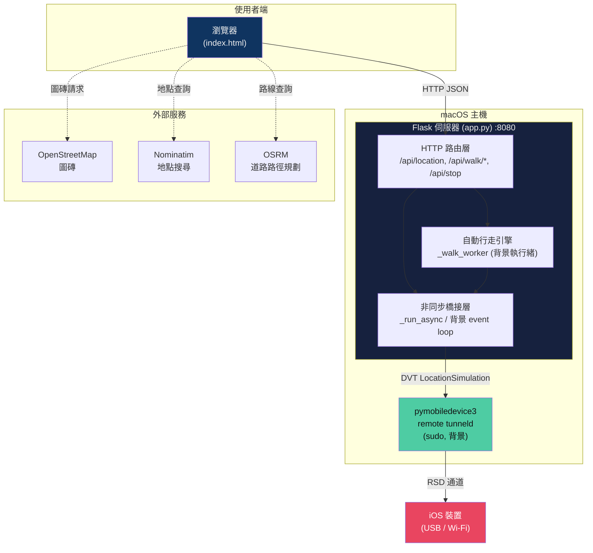
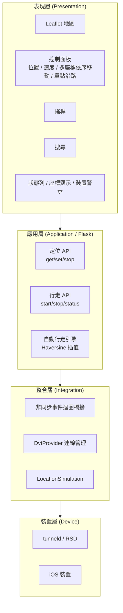
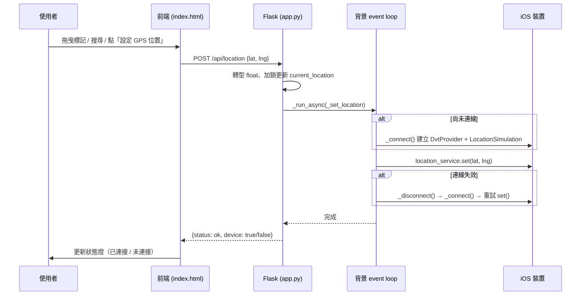
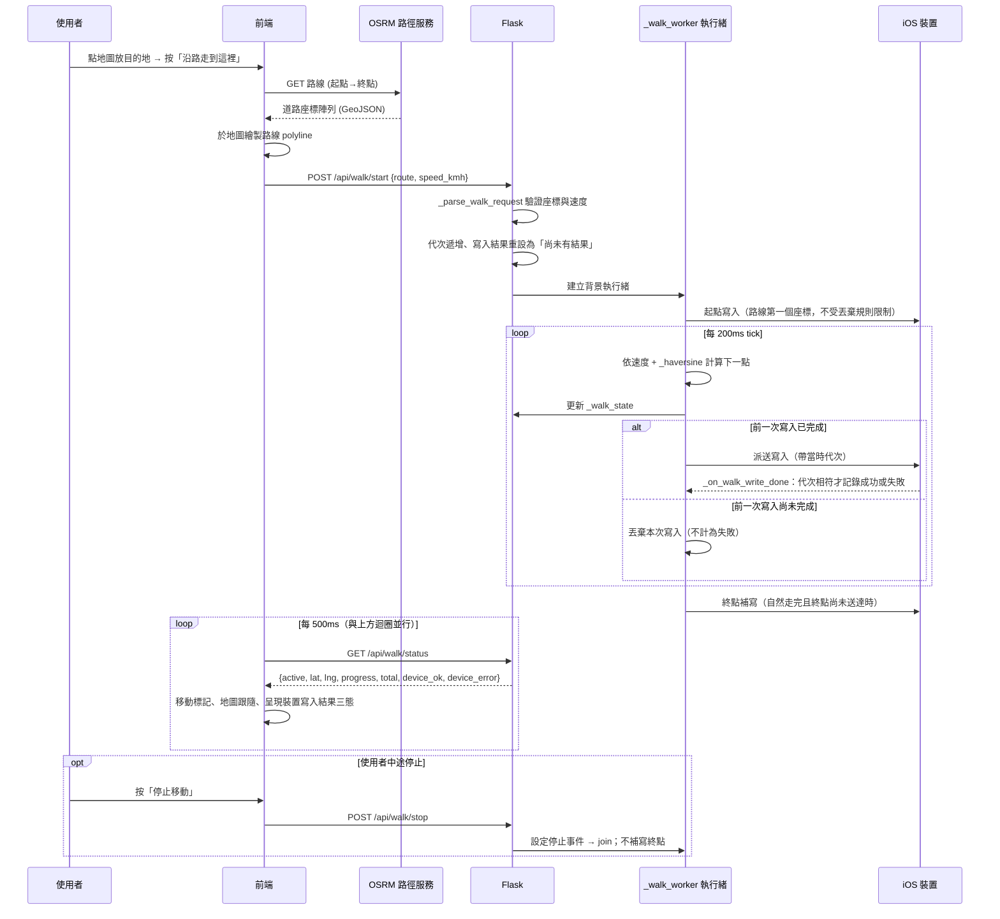
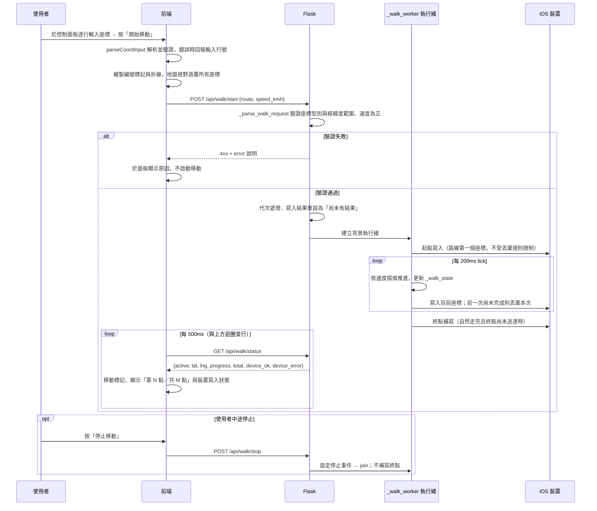
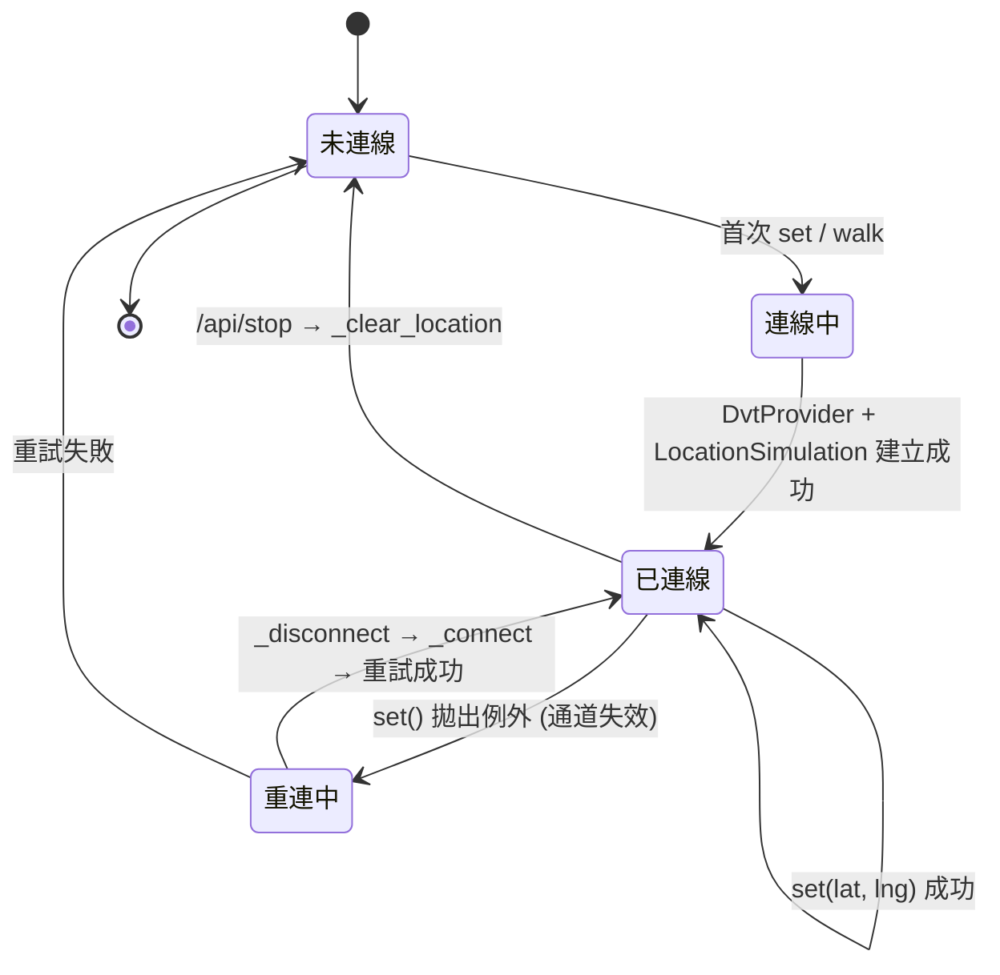
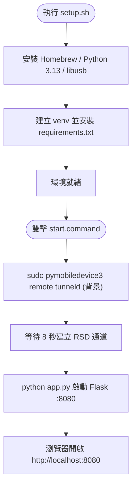

# iOS GPS 模擬器 — 系統架構設計圖

本文件說明「iOS GPS 模擬器」的整體系統架構、模組分層、資料流向與部署方式。
所有圖表以 [Mermaid](https://mermaid.js.org/) 語法撰寫，可在支援 Mermaid 的 Markdown 檢視器（GitHub、VS Code + 外掛、Typora 等）中直接渲染。

---

## 1. 系統概觀

本專案是一套執行於 **macOS** 的工具，透過網頁地圖介面，將指定的經緯度座標「模擬」注入到已連線的 **iOS 裝置**，使裝置回報虛擬的 GPS 位置。除了單點定位外，還支援搖桿即時移動與沿真實道路自動行走。

| 項目 | 內容 |
|------|------|
| 執行平台 | macOS（需 Python 3.13+） |
| 後端框架 | Flask（Python） |
| 前端 | 單頁 HTML + Leaflet 地圖 + nipplejs 搖桿 |
| 裝置通訊 | pymobiledevice3（DVT / Instruments 通道） |
| 對外服務 | OpenStreetMap 圖磚、Nominatim 地點搜尋、OSRM 路徑規劃 |
| 服務埠 | HTTP `8080` |

---

## 2. 整體架構圖



**圖例說明**
- 實線：主要控制/資料流（座標注入路徑）。
- 虛線：前端直接向第三方服務發出的請求（不經過本地後端）。

---

## 3. 分層架構



| 層級 | 職責 | 對應程式 |
|------|------|----------|
| 表現層 | 地圖操作、控制面板（含多座標依序移動）、搖桿、搜尋、狀態顯示 | `templates/index.html` |
| 應用層 | HTTP API、業務邏輯、自動行走運算 | `app.py` 路由與 `_walk_worker` |
| 整合層 | 管理與 iOS 的非同步連線、注入座標 | `app.py` 的 `_connect` / `_set_location` 等 |
| 裝置層 | 建立加密通道、實際模擬定位 | `pymobiledevice3 tunneld` + iOS |

---

## 4. 單點定位資料流（設定 GPS 位置）



---

## 5. 自動沿路行走資料流

本章涵蓋兩條自動移動路徑。兩者只在「送出走路開始請求之後」合流：後端的推進、寫入與收尾邏輯完全相同，差別全在前段如何取得座標。

### 5.1 單點沿路移動

由外部路線規劃服務取得道路座標，座標會被吸附到道路上。




### 5.2 多座標依序移動

座標由使用者逐行輸入，不經過任何外部服務，也不吸附道路——落點就是輸入的座標。



與 5.1 的差異：**沒有外部路線規劃服務參與**，且多了前端的座標解析與後端的輸入驗證兩道關卡。

---

## 6. 連線狀態機（iOS 定位服務）



---

## 7. 部署與啟動流程



**相依套件（requirements.txt）**
- `flask>=3.0` — Web 伺服器與 API
- `pymobiledevice3>=4.0` — 與 iOS 裝置通訊、模擬定位

---

## 8. 關鍵設計決策

| 決策 | 原因 |
|------|------|
| 專屬背景 event loop 執行緒 | Flask 為同步框架，pymobiledevice3 為 async；以獨立 loop 承載非同步呼叫並保持長連線，避免每次請求重建成本。 |
| 持久化 DVT 連線（全域 `_dvt` / `_location_service`） | 連線建立成本高，重複使用可讓即時搖桿與自動行走達到低延遲更新。 |
| set() 失敗自動重連一次 | iOS 通道可能因閒置或裝置狀態而失效，單次重連提升穩定性。 |
| 自動行走放在後端執行緒 | 位置需以固定節奏（200ms）持續注入，交由後端可不受瀏覽器分頁節流影響；前端僅輪詢顯示。 |
| 前端直連第三方服務 | 圖磚、地點搜尋、路徑規劃皆由瀏覽器直接請求，後端無須代理，降低伺服器負載。 |
| 重疊的裝置寫入直接丟棄，不排隊 | 移動期間每個週期都會派送一次寫入。若改成排隊，慢速裝置會讓待寫入無上界累積，裝置位置離顯示位置愈來愈遠。丟棄較舊的座標不損失資訊——較新的座標已包含它。丟棄不計為失敗、不回報為錯誤。 |
| 路線起點與終點是丟棄規則的兩個具名例外 | 推進迴圈的不變式是「先前進、再視情況寫入」，這在路線中段成立，在兩個端點都不成立：起點不該先前進，終點之後沒有下一個週期可補救。兩者以不受丟棄限制的方式派送；終點補寫只在自然走完時進行，使用者按停止時不補。 |
| 寫入完成回呼以代次辨識所屬輪次 | 停止走路只等待工作執行緒結束，不等也不取消已派送的寫入協程。上一輪的結果若在新一輪開始後才回來，會覆寫新一輪剛重設的狀態。每輪配一個遞增代次，回呼比對不符就整筆丟棄。取消協程無法保證及時生效，代次比對則行為確定。 |
| 裝置寫入結果採三態而非布林 | 走路剛開始時第一次寫入的結果還沒回來。若預設為成功，前端第一次輪詢就會在毫無根據下宣稱裝置已連接。以「尚未有結果／成功／失敗」表達，前端只在明確成功時才點亮狀態。 |
| 第三方函式庫載入失敗必須在頁面上看得見 | 函式庫失效曾讓半個頁面靜默失效，使用者只看到彼此無關的症狀。每個函式庫各自判定可用性，任一個的失敗不遮蔽另一個的回報；失效時在該控制項的位置顯示不可用訊息，並停用會用到它的控制項。 |
| 走路輸入驗證前置於啟動工作執行緒 | 型別錯誤若留到背景執行緒才爆開，走路狀態已設為移動中、回應也送出了，使用者看到的是「按下開始卻馬上停下」，與成因毫無關聯。驗證提前到回應之前，且排在停止前一輪走路之前——被拒絕的請求不得動到任何走路狀態。 |

---

## 9. 目錄結構

```text
GPS/
├── app.py                 # Flask 後端主程式（API + 自動行走引擎 + 裝置整合）
├── templates/
│   └── index.html         # 單頁前端（地圖、搖桿、搜尋、控制面板、自動行走 UI）
├── requirements.txt       # Python 相依套件
├── setup.sh               # 環境安裝腳本（Homebrew / Python / venv）
├── start.command          # 一鍵啟動（tunneld + Flask）
├── venv/                  # Python 虛擬環境（自動產生）
├── .gitignore             # 版本控制忽略清單
├── CLAUDE.md              # 給 AI 協作工具的專案指示
├── .spectra.yaml          # Spectra 應用設定（語系、工作流開關）
├── .spectra/              # Spectra 內部狀態（暫存的變更等）
├── .claude/               # Claude Code 的技能與設定
├── openspec/              # 規格驅動開發的規格與變更提案
│   ├── specs/             # 現行規格：每個能力一個目錄
│   │   ├── auto-walk/
│   │   ├── control-panel-layout/
│   │   ├── device-location-sync/
│   │   ├── joystick-control/
│   │   ├── page-initialization/
│   │   └── project-documentation/
│   └── changes/           # 變更提案；完成後移入 archive/
└── docs/                  # 專案文件（本資料夾）
    ├── 系統架構設計圖.md
    └── 主要功能程式碼介紹.md
```

未列出的項目：`__pycache__/` 與 `.DS_Store` 為執行期或作業系統自動產生，`venv/` 由 setup.sh 建立，三者皆不屬於原始碼。
